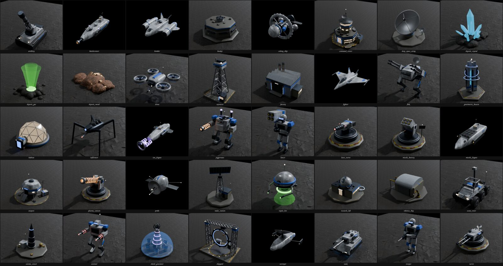

# Cosmic Conflict

A multiplayer 3D real-time strategy game in space, built with Rust and [Bevy](https://bevyengine.org) 0.20.

Every commander starts on a **home planet of their own** — a full 3D globe whose entire surface
holds resources. Build extractors anywhere on your world, raise an army and a fleet, colonise
neutral planets and take the star system.

A research tree of 38 technologies in seven fields unlocks robots, artillery, frigates, a
battlecruiser, five kinds of defences and four kinds of sensors, and upgrades armour, shields,
weapons, sensors and the economy. Combat uses damage kinds (kinetic, laser, explosive, plasma,
ion) against armour classes, regenerating shields, splash, shield and repair fields, and cloaked
units that only detectors reveal.

## Quick start

```sh
cargo run                        # game client (Host Game / Join Game in the menu)
cargo run -p cc_server           # dedicated server (default port 47900)
cargo test --workspace           # rules, star-system generation, simulation, full TCP match
cargo run --release -p cosmic-conflict --no-default-features   # optimised build without dynamic linking
```

Linux needs Bevy's system dependencies, see the
[Bevy setup guide](https://bevyengine.org/learn/quick-start/getting-started/setup/#installing-os-dependencies).
The toolchain (Rust 1.99.1) is pinned in `rust-toolchain.toml`.

## Controls

| Input | Action |
|---|---|
| Left click / drag | select (double click: all units of that kind on screen) |
| Right click | move, attack an enemy, help build a construction site |
| WASD / arrows | move over the planet (Shift: faster) |
| Q / E | turn the view left / right |
| Middle drag | turn and tilt the view · Shift + middle drag: drag the ground |
| T | cycle top view → tilted → low view · Ctrl + wheel: tilt freely |
| Mouse wheel, PageUp / PageDown | zoom (from the surface out to the whole system; the tilt fades out when zoomed out) |
| C | free camera: WASD fly, Q / E down / up, Shift faster, middle drag look, wheel dash; C again returns |
| Tab / Shift+Tab, H, Space | next planet, home planet, system view |
| F | focus the selection · Esc cancels placement / selection |
| R | research tree (click a tech to research it in a lab) |

## Workspace

| Crate | Purpose |
|---|---|
| `crates/cc_core` | rules vocabulary, content database (`data/*.ron`), deterministic star-system generation |
| `crates/cc_protocol` | client/server messages and the TCP transport |
| `crates/cc_sim` | the authoritative simulation (runs on the server) |
| `crates/cc_server` | lobby + match server: library (embedded "Host Game") and binary `cc-server` |
| `crates/game` | the Bevy client `cosmic-conflict`: rendering, UI, input |

More: [docs/GAME_DESIGN.md](docs/GAME_DESIGN.md), [docs/ARCHITECTURE.md](docs/ARCHITECTURE.md),
[docs/STATUS.md](docs/STATUS.md).

## 3D models

Every unit, building and resource deposit is generated procedurally in Blender (Python): seeded
hard-surface generators with real bevels, weighted normals, greebles and a baked
ambient-occlusion map, textured with CC0 photo materials from Poly Haven and ambientCG.

```sh
python3 tools/fetch_textures.py                                   # CC0 textures (+ credits)
blender -b --python tools/blender/build_models.py                 # all models -> crates/game/assets/models
blender -b --python tools/blender/build_models.py -- --preview /tmp/m.png tank fighter   # Cycles preview
```



## Licence

GPL-3.0-or-later. Asset credits: [textures](crates/game/assets/textures/CREDITS.md) (all CC0),
[3D models](crates/game/assets/models/CREDITS.md) (generated for this project),
[audio](crates/game/assets/audio/CREDITS.md).
